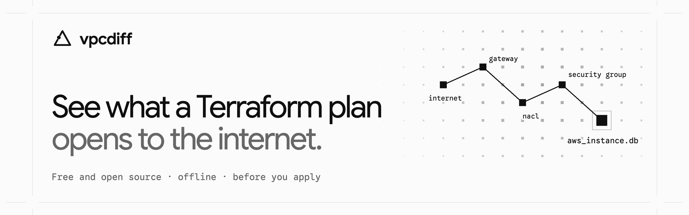
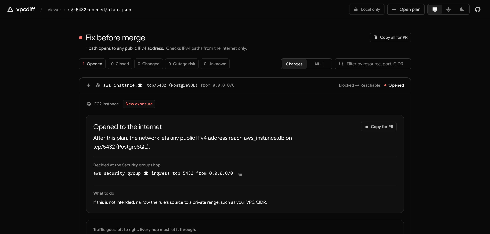

<p align="center">
  <a href="https://isthatpratik.github.io/vpcdiff/">
    <picture>
      <source media="(prefers-color-scheme: dark)" srcset="docs/assets/banner-dark.png">
      
    </picture>
  </a>
</p>

<p align="center">
  <a href="https://github.com/isthatpratik/vpcdiff/actions/workflows/ci.yml"></a>
  <a href="https://github.com/isthatpratik/vpcdiff/releases/latest"></a>
  <a href="https://github.com/marketplace/actions/vpcdiff"></a>
  <a href="LICENSE"></a>
</p>

<p align="center">
  <a href="https://isthatpratik.github.io/vpcdiff/app/"><b>Try it live</b></a> ·
  <a href="https://isthatpratik.github.io/vpcdiff/">Site</a> ·
  <a href="#github-action">GitHub Action</a> ·
  <a href="#quick-start-cli">CLI</a> ·
  <a href="#support-matrix">Support matrix</a>
</p>

# vpcdiff

See what a Terraform plan opens to the internet, before you run `apply`.

`vpcdiff` reads a Terraform plan (`terraform show -json`), works out which AWS, Google
Cloud, and Azure resources the internet can reach before and after the plan, and shows
what changes:

- paths the plan opens (for example, `0.0.0.0/0 → aws_instance.db` on tcp/5432)
- paths the plan closes, and paths whose allowed sources change
- paths it cannot decide, reported as unknown with the reason, never guessed
- outage risk: a security group or route on an open path that the plan replaces by
  deleting it first

Every result names the hop and the rule that decided it (public IP, internet gateway,
network ACL, security group, firewall rule, route), with a link to the cloud's
documentation. It needs no cloud account or credentials, and the viewer never sends your
plan anywhere.

<p align="center">
  
</p>

> **Status:** [v0.3.0](https://github.com/isthatpratik/vpcdiff/releases/tag/v0.3.0) checks
> AWS paths from the internet (IPv4 and IPv6) and paths inside the VPC, including across VPC
> peering and transit gateways, for instances, databases, Aurora, ECS services, and load
> balancers; and paths from the internet to Google Cloud VMs and Cloud SQL, and to Azure VMs
> (see the [support matrix](#support-matrix)). Design notes are in [`docs/design`](docs/design),
> [`docs/adr`](docs/adr), and [`docs/semantics`](docs/semantics).

## GitHub Action

```yaml
- run: terraform show -json tfplan > plan.json
- uses: isthatpratik/vpcdiff@v0.3.0
  with:
    plan: plan.json
    # fail-on: added   # added | changed | unknown | never
    # added = new exposure to the internet; changed also counts
    # paths inside the VPC that the plan opens or cuts
```

It comments on the pull request, writes the report to the job summary, and fails the
check when the plan opens a path. Full setup: [`packages/action`](packages/action/README.md).
Listed on the [GitHub Marketplace](https://github.com/marketplace/actions/vpcdiff).

## Quick start (CLI)

```sh
pnpm install && pnpm build
cd infra
node ../packages/cli/dist/vpcdiff.mjs
```

With no arguments, in a terminal, `vpcdiff` asks which plan to read. It finds plan JSON
and binary plans (`tfplan`, `*.tfplan`) in the folder, converts a binary plan with
`terraform show -json`, or runs `terraform plan` for you after you confirm. Then it
prints the report and offers next steps: every path, one path in full, or a Markdown
summary for the pull request.

<p align="center">
  
</p>

To pass a plan yourself:

```sh
terraform -chdir=infra plan -out=tfplan
terraform -chdir=infra show -json tfplan > plan.json
node packages/cli/dist/vpcdiff.mjs plan.json
```

In a terminal, the report leads with the verdict. Example for
[`fixtures/sg-5432-opened`](fixtures/sg-5432-opened):

```text
vpcdiff  plan.json
Fix before merge · 1 path opens to any public IPv4 address
1 opened · 0 closed · 0 changed · 0 outage risk · 0 unknown

● Opened to the internet
  aws_instance.db  tcp/5432 (PostgreSQL)  Blocked → Reachable
  After this plan, the network lets any public IPv4 address reach aws_instance.db on tcp/5432 (PostgreSQL).
  Decided at the Security groups hop:
    aws_security_group.db ingress tcp 5432 from 0.0.0.0/0
  What to do: If this is not intended, narrow the rule's source to a private range, such as your VPC CIDR.

  Hop               Before       After
  Security groups   denies       allows      aws_security_group.db
  Target            not checked  allows      aws_instance.db
  NACL outbound     not checked  allows      default NACL of aws_vpc.main
  Return route      not checked  allows      aws_route_table.public
  4 other hops are the same before and after.
```

In pipes and CI, the text output is stable plain text with every hop:

```text
vpcdiff: 1 added, 0 removed, 0 changed, 0 unknown, 0 unchanged

ADDED     internet -> aws_instance.db  tcp/5432
  before: blocked at security-group: no ingress rule of aws_security_group.db allows tcp/5432 from the internet
  after:  allowed from internet
    public-ip        allow   aws_instance.db associate_public_ip_address = true
    ...
```

Options: `--format text|json|markdown`, `--all` (also unchanged paths),
`--fail-on added|changed|unknown|never` (default `added`; `added` also fails when the plan
widens a path from the internet, for example a rule that goes from one host to
`0.0.0.0/0`). Set `NO_COLOR=1` to turn color off. Exit codes: `0` no failing paths, `1` failing paths, `2` usage or input
error.

## Interfaces

| Interface | Use |
|---|---|
| Web viewer | Load a plan in the browser. Each path, from the internet or inside the VPC, with a verdict in plain words and a hop table. The plan never leaves your device. |
| CLI | Guided mode in a terminal, or text, JSON, or Markdown output. Exit code `1` when the plan adds new exposure. |
| GitHub Action | Posts a reachability summary on the pull request. |

All three use the same engine.

## Goals

- **Correct.** Results are checked against AWS VPC Reachability Analyzer on a fixture corpus.
- **Explainable.** Every allowed or blocked path cites the rule that decided it.
- **Honest.** When the engine cannot decide a path, it returns `unknown` with a reason. It does not guess.
- **Offline.** No AWS credentials. No network calls.

## Non-goals

- Live account scanning. Use AWS Reachability Analyzer or Batfish for that.
- Generic policy rules ("no SSH from 0.0.0.0/0"). Checkov and Trivy already do that well.
- Clouds other than AWS, for now.

## Support matrix

Plans from Terraform (`terraform show -json`) and OpenTofu (`tofu show -json`) work the
same way: OpenTofu writes the same plan JSON format. CI plans every fixture with
OpenTofu 1.13 and checks that the result matches the Terraform result byte for byte.

What the engine models today. "unknown" means a path that such a resource can change is
reported as `unknown` with a reason, never as allowed or blocked by guess.

| Resource | Status |
|---|---|
| `aws_vpc` (primary IPv4 CIDR), `aws_subnet` | supported |
| `aws_internet_gateway`, `aws_internet_gateway_attachment` | supported |
| `aws_route_table` (inline routes), `aws_route`, `aws_route_table_association` | supported |
| Main route table: `aws_default_route_table`, `aws_main_route_table_association`, unmanaged default | supported |
| `aws_security_group` (inline), `aws_security_group_rule`, `aws_vpc_security_group_ingress_rule` | supported (IPv4 CIDR and security group sources) |
| `aws_default_security_group`, unmanaged default security group | supported |
| `aws_network_acl` (inline), `aws_network_acl_rule`, `aws_network_acl_association`, `aws_default_network_acl`, unmanaged default NACL | supported |
| `aws_instance` (endpoint), `aws_eip`, `aws_eip_association` | supported |
| Egress rules: inline `egress`, `aws_security_group_rule`, `aws_vpc_security_group_egress_rule` | supported for paths inside the VPC; internet paths do not need them (security groups are stateful) |
| Paths inside the VPC: endpoint to endpoint through a security group reference (`security_groups`, `source_security_group_id`, `referenced_security_group_id`, `self`) | supported in one VPC, across an active VPC peering connection (`aws_vpc_peering_connection`, `_accepter`), and through a transit gateway in the plan (IPv4); middlebox routes are unknown |
| `aws_db_instance` (endpoint; `publicly_accessible`, `aws_db_subnet_group`) | supported |
| `aws_lb` (endpoint; internet-facing ALB and NLB, `aws_lb_listener` for NLBs without groups) | supported |
| `aws_rds_cluster_instance` (Aurora endpoint; groups and subnet group from `aws_rds_cluster`) | supported |
| `aws_ecs_service` (endpoint with awsvpc `network_configuration`; public IP on Fargate only) | supported |
| `aws_elb` (Classic Load Balancer endpoint in a VPC) | supported |
| Gateway Load Balancers, ECS services in bridge or host mode | noted |
| Customer-managed prefix lists in the plan (`aws_ec2_managed_prefix_list`, `aws_ec2_managed_prefix_list_entry`) in rules and routes | supported |
| Prefix lists outside the plan (AWS-managed) | undecided sources; unknown when nothing else decides |
| Secondary VPC CIDR blocks (`aws_vpc_ipv4_cidr_block_association`) | supported (an IPAM-allocated block is unknown) |
| Instances with a `network_interface` block, `aws_network_interface`, `aws_network_interface_sg_attachment`, Elastic IPs on an interface | supported for the primary interface; more than one is unknown |
| VPN route propagation, `aws_network_interface_attachment` | unknown |
| Response routes to a NAT gateway, a VPC peering connection, or a blackhole | supported (they block internet paths) |
| Transit Gateway: `aws_ec2_transit_gateway`, `_vpc_attachment`, `_route_table`, `_route`, `_route_table_association`, `_route_table_propagation`, default association and propagation, security group referencing | supported for paths inside the VPC between VPCs; internet paths through a transit gateway, peering/VPN/Connect attachments, and default route table or prefix list reference resources are unknown |
| VPN gateway, middlebox network interfaces | unknown (routing continues outside the plan) |
| `aws_vpc_endpoint` Interface (target inside the VPC) and Gateway (prefix list route; its addresses undecided) | supported |
| IPv6 from the internet to EC2 instances and dual-stack load balancers; egress-only internet gateways | supported (paths inside the VPC are IPv4 only) |

Paths evaluated: from the internet to each endpoint, for every TCP and UDP port that one
of its security groups opens to a public address.

### Google Cloud (first scope, [docs/semantics/gcp.md](docs/semantics/gcp.md))

| Resource or behavior | Status |
|---|---|
| `google_compute_instance` (endpoint; external IP from `access_config`, network tags, service accounts) | supported for one network interface; more than one is unknown |
| `google_compute_firewall` ingress rules (priority, allow and deny, deny wins a tie, implied deny, target tags and service accounts, `source_ranges`, disabled) | supported |
| `google_compute_network` (system default route, `delete_default_routes_on_create`), `google_compute_subnetwork`, `google_compute_route` to the default internet gateway | supported; other custom routes and a deleted default route are unknown |
| The `default` network or any network outside the plan | unknown (its pre-populated rules are not in the plan) |
| Network and hierarchical firewall policies, policy-based routes | unknown when in the plan; organization and folder policies are never seen |
| `google_sql_database_instance` (public IP from `ipv4_enabled`, `authorized_networks` on the engine's port: PostgreSQL, MySQL, SQL Server) | supported; the Cloud SQL Auth Proxy and connectors (IAM) are not modeled |
| IPv6, load balancers, Cloud SQL private IP, paths between VMs | not modeled yet |

Google Cloud paths carry `"provider": "gcp"` in the JSON result ([ADR 0011](docs/adr/0011-multi-cloud.md)).

### Azure (first scope, [docs/semantics/azure.md](docs/semantics/azure.md))

| Resource or behavior | Status |
|---|---|
| `azurerm_linux_virtual_machine`, `azurerm_windows_virtual_machine` (endpoint; one network interface with one IP configuration) | supported; more are unknown |
| `azurerm_public_ip` on the interface (Standard SKU, closed unless an NSG allows) | supported; Basic SKU (retired) is unknown |
| `azurerm_network_security_group` (inline rules), `azurerm_network_security_rule`, subnet and interface associations, default rules, priority order, service tags `Internet`, `VirtualNetwork`, `AzureLoadBalancer` | supported; other service tags, application security groups as destination, and partial destinations are unknown |
| System routes, `azurerm_route_table` (inline), `azurerm_route`, `azurerm_subnet_route_table_association` | supported; a more specific route to an appliance or gateway is undecided |
| Load balancers, NAT gateways, Azure Firewall, peering, Virtual Network Manager admin rules, IPv6 | not modeled yet |

Azure paths carry `"provider": "azure"`. Fixture plans use a local stand-in for the Azure
endpoints, so no Azure account is used.

## Roadmap

In order. Each item lands with a spec, unit tests, fixture tests with written proofs, a
security review, and an updated support matrix.

1. [Paths inside the VPC](https://github.com/isthatpratik/vpcdiff/issues/32): security
   group references, so "load balancer to service" or "web to database" changes show up.
   Done in v0.2.0.
2. [More AWS networking](https://github.com/isthatpratik/vpcdiff/issues/33): done in
   v0.2.0 for NAT gateways, VPC peering, VPC endpoints, IPv6, and prefix lists. Secondary
   VPC CIDRs, network interfaces, and paths between VPCs through a transit gateway: done in
   v0.3.0 (#93, #94).
3. [OpenTofu support](https://github.com/isthatpratik/vpcdiff/issues/34): done in v0.2.0. Every
   fixture is also planned with OpenTofu in CI, and the result must match byte for byte.
4. [More endpoints](https://github.com/isthatpratik/vpcdiff/issues/35), done in v0.2.0: Aurora, ECS
   services, and Classic Load Balancers.
5. [Azure and Google Cloud](https://github.com/isthatpratik/vpcdiff/issues/36): done in
   v0.3.0 ([ADR 0011](docs/adr/0011-multi-cloud.md)). Google Cloud VMs and Cloud SQL, and
   Azure VMs, from the internet (#95, #96).

## Repository layout

```
packages/engine   pure reachability engine (no I/O)
packages/cli      command-line interface
packages/action   GitHub Action
apps/viewer       client-side web viewer
fixtures          plan.json + expected results, verified against AWS
docs              design doc, ADRs, AWS semantics notes
```

## License

[Apache-2.0](LICENSE)
